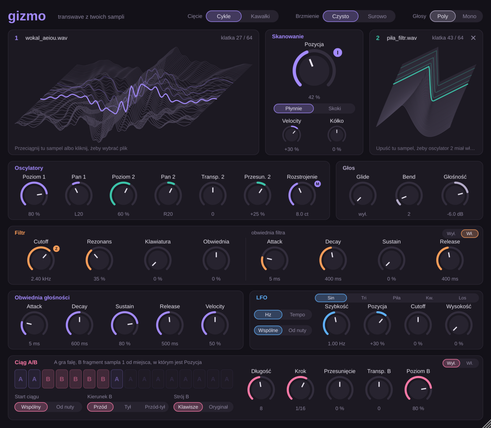

# Gizmo

Syntezator VST3 inspirowany Ensoniq Fizmo. Przeciągasz na niego dowolny sampel, a on tnie go na 64 klatki (pojedyncze cykle fali). Gałka **Pozycja** przesuwa się po nich tak, jak transwave'y w Fizmo: oś czasu sampla staje się parametrem, którym sterujesz.



## Pobieranie i instalacja

Gotowe pliki są w zakładce **Releases** → *Gizmo (najnowsza wersja)*. Każda zmiana w kodzie automatycznie buduje nową wersję.

### Windows

1. Pobierz `Gizmo-Windows-VST3.zip` i rozpakuj.
2. Skopiuj folder `Gizmo.vst3` do `C:\Program Files\Common Files\VST3`.
3. W Abletonie: *Options → Preferences → Plug-Ins*, włącz *Use VST3 Plug-In System Folders* i kliknij *Rescan*.

### macOS

1. Pobierz `Gizmo-macOS-VST3.zip` (i ewentualnie `Gizmo-macOS-AU.zip`), rozpakuj.
2. Skopiuj `Gizmo.vst3` do `~/Library/Audio/Plug-Ins/VST3`, a `Gizmo.component` do `~/Library/Audio/Plug-Ins/Components`.
3. Wtyczka nie jest podpisana przez Apple, więc zdejmij blokadę w Terminalu:

   ```
   xattr -dr com.apple.quarantine ~/Library/Audio/Plug-Ins/VST3/Gizmo.vst3
   xattr -dr com.apple.quarantine ~/Library/Audio/Plug-Ins/Components/Gizmo.component
   ```

4. W Abletonie: *Settings → Plug-Ins*, włącz *Use VST3 Plug-In System Folders* (i *Use Audio Units*) i kliknij *Rescan*.

## Jak tego używać

- **Wczytywanie.** Przeciągnij plik audio (WAV, AIFF, FLAC, OGG, MP3, do 60 sekund) na panel 1 z folderu albo z przeglądarki Abletona, albo kliknij panel i wybierz plik. Oscylator 2 domyślnie gra tablicę 1. Upuść na jego panel inny sampel, żeby miał własną; krzyżyk wraca do tablicy 1.
- **Cięcie.** *Cykle* wycina z każdego fragmentu jeden okres fali (najlepsze dla dźwięków o wyraźnej wysokości: wokal, smyczki, syntezatory). Fragmenty bez wysokości (szum, perkusja) są wtedy brane jako kawałki. *Kawałki* zawsze bierze stały kawałek nagrania, co daje bardziej szorstkie, ziarniste brzmienie.
- **Przejścia.** *Płynnie* miesza sąsiednie klatki. *Skoki* zmienia klatkę dopiero na końcu cyklu, jak transwave w Ensoniq.
- **Brzmienie.** *Czysto* usuwa aliasing. *Surowo* go zostawia, co brzmi bardziej cyfrowo.
- **Filtr.** Czterobiegunowy dolnoprzepustowy z rezonansem, śledzeniem klawiatury i własną obwiednią.
- **LFO.** Sinus, trójkąt, piła, kwadrat albo losowy, w Hz albo w tempie Abletona. *Wspólne* to jedno LFO dla wszystkich nut, *Od nuty* startuje od nowa z każdą nutą. Steruje pozycją, cutoffem i wysokością.

Projekt z Gizmo pamięta wczytane tablice i sample, więc nie potrzebuje oryginalnych plików.

## Ciąg A/B

Ciąg przełącza w rytmie tempa Abletona między dwoma źródłami: **A** to fala z tablicy (oba oscylatory), **B** to dłuższy fragment samego sampla z panelu 1, zaczynający się w miejscu, które wskazuje Pozycja.

- Klikasz kroki, żeby zmieniać A na B i z powrotem; przeciągnięcie maluje kilka kroków naraz. *Długość* to liczba kroków (do 16), *Krok* to ich wartość rytmiczna (1/4 do 1/32).
- Każde wejście w B zaczyna fragment od początku, a kolejne B pod rząd grają go dalej. W `AABBBBBA` fragment startuje na trzecim kroku i gra przez pięć kroków.
- *Kierunek B*: przód, tył (ten sam kawałek odwrócony) albo przód-tył.
- *Strój B*: *Klawisze* transponuje fragment jak sampler (względem wykrytej wysokości sampla), *Oryginał* gra go w oryginalnej wysokości. *Transp. B* przesuwa go o półtony.
- *Start ciągu*: *Wspólny* trzyma się taktów Abletona, *Od nuty* zaczyna ciąg od nowa z każdą nutą.
- *Przesunięcie* przesuwa początek fragmentu względem Pozycji, *Poziom B* ustawia jego głośność.

Filtr i obwiednia głośności działają na oba źródła.

## Gałki F-I-Z-M-O

Litery na gałkach pokazują, czym były gałki Fizmo: **I** to Pozycja, **Z** to Cutoff, **M** to Rozstrojenie. W Fizmo jeden preset składał się z czterech warstw, a te gałki zmieniały wszystkie naraz. W Abletonie zrobisz to tak:

1. Włóż kilka kopii Gizmo do jednego *Instrument Racka* (każda w osobnym łańcuchu, z innym samplem).
2. Przypisz Pozycję, Cutoff i Rozstrojenie z każdej kopii do tych samych makr Racka.
3. Na **F** i **O** daj, co chcesz, na przykład *LFO na pozycję* i *Rezonans*.

## Budowanie samemu

Potrzebujesz CMake 3.22+ i kompilatora C++20. JUCE pobierze się sam.

```
cmake -B build -DCMAKE_BUILD_TYPE=Release
cmake --build build --config Release
```

Testy offline (import, aliasing, filtr, zapis stanu, zrzut interfejsu):

```
cmake -B build -DGIZMO_BUILD_TESTS=ON
cmake --build build --target GizmoTests
```

Gizmo używa frameworka [JUCE](https://juce.com), który jest dostępny na licencji AGPLv3 albo komercyjnej.
