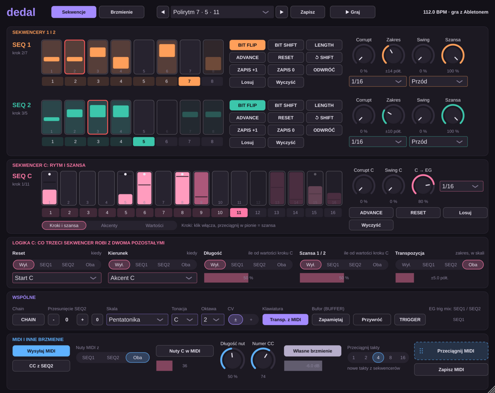

# Dedal

Generatywny syntezator VST3 zbudowany wokół dwóch sekwencerów, które same się zmieniają, i trzeciego, rytmicznego, który steruje logiką dwóch pierwszych. Inspiracją był generatywny syntezator półmodularny z dwoma sekwencerami 8-bitowymi; tu bez patch baya, za to z wewnętrznymi połączeniami z gałkami „ile”. Gra sam, w tempie Abletona. Swoje nuty wysyła też jako MIDI, więc może sterować innym instrumentem.

## Pobieranie

Zakładka **Releases** → *Gizmo, Solista i Dedal (najnowsza wersja)*: `Dedal-Windows-VST3.zip`, `Dedal-macOS-VST3.zip`, `Dedal-macOS-AU.zip`. Instalacja jak przy Gizmo (opis w [głównym README](../README.md)).

## Sekwencery 1 i 2

Każdy ma 8 kroków (bitów). Włączony bit ma losowe napięcie, które przez **Zakres** (CV RANGE, ± półtony) zamienia się w wysokość. SEQ1 gra VCO, SEQ2 gra MOD VCO. Do tego mogą sterować wavefolderem i filtrem.

- **CORRUPT**: do połowy zmienia wysokości włączonych kroków (do ok. 25 %), za połową także włącza i wyłącza kroki (do ok. 50 %). Na zero pętla stoi w miejscu.
- **BIT FLIP**: przełącza bit pod głowicą zapisu (czerwona ramka). **ZAPIS +1** przesuwa głowicę zapisu względem głowicy odtwarzania, a **ZAPIS 0** ustawia je razem.
- **BIT SHIFT**: obraca sekwencję o krok w prawo. **↺ SHIFT** przywraca stan sprzed obrotów.
- **LENGTH**: skraca o krok, a z 1 wraca do 8. Długość można też kliknąć w rzędzie cyfr.
- **ADVANCE**, **RESET** (wraca do kroku 1), **ODWRÓĆ** (zmienia kierunek), **Losuj**, **Wyczyść**.
- **Kierunek**: przód, tył, wahadło albo losowo.
- **Szansa**: prawdopodobieństwo, że włączony krok zagra.
- **Krok** (podział względem tempa Abletona) i **Swing**: osobno dla każdego sekwencera.
- Klik w krok włącza go albo wyłącza. Przeciągnięcie w pionie zmienia jego napięcie.

**CHAIN** łączy oba w jedną sekwencję do 16 kroków, po której jadą dwie głowice. **Przesunięcie SEQ2** (albo BIT SHIFT na SEQ2 w trybie CHAIN) ustawia drugą głowicę o kilka kroków przed pierwszą. Obie grają wtedy różne dźwięki z tej samej sekwencji, więc wychodzą interwały i akordy. Preset *Akordy z przesunięcia* to pokazuje.

**Wspólne**:
- **Skala**: 16 trybów, m.in. durowa, pentatonika, moll harmoniczna, hirajoshi, hang drum.
- **Tonacja** i **Oktawa**.
- **CV**: polaryzacja ± albo +.
- **Transp. z MIDI**: nuta z klawiatury przesuwa tonikę.
- **Bufor**: zapamiętuje sekwencję i przywraca ją.
- **TRIGGER**: ręcznie wyzwala obwiednie.
- **EG trig mix**: który sekwencer wyzwala obwiednie i z jaką siłą.

Gałka **SEQ1 → wys.** (i SEQ2 → wys.) na samej górze pokazuje **QTZ**: wysokość jest wtedy w skali. Niżej przesuwa ją płynnie, bez skali.

## Sekwencer C: rytm i szansa

16 kroków, a każdy ma:
- **wyzwalacz**: włączony albo wyłączony,
- **akcent** (kropka),
- **szansę** (wysokość wypełnienia),
- **wartość** (pozioma kreska).

Edycję wybierasz pod rzędem: *Kroki i szansa*, *Akcenty* albo *Wartości*. C ma własną długość (1–16), krok, swing i Corrupt (zmienia szanse, wartości, a za połową także same kroki i akcenty).

Długości wszystkich trzech sekwencerów są niezależne. Przy 7, 5 i 11 krokach spotykają się w tym samym miejscu dopiero co 385 kroków (preset *Polirytm 7 · 5 · 11*).

**Logika C**, czyli co C robi z SEQ1 i SEQ2 (każdą funkcję kierujesz do SEQ1, SEQ2 albo obu):

| Funkcja | Działanie |
| --- | --- |
| **Reset** | wraca do kroku 1 na starcie cyklu C, na akcencie C albo na każdym kroku C |
| **Kierunek** | odwraca kierunek (jak wyżej: start, akcent albo każdy krok) |
| **Długość** | ustawia długość sekwencera z wartości kroku C; „ile” miesza ją z długością z gałki |
| **Szansa** | wartość kroku C podnosi albo obniża szansę SEQ1 i SEQ2 |
| **Transpozycja** | wartość kroku C przenosi melodię w obrębie skali, o tyle półtonów, ile ustawisz |

**C → EG** pozwala C wyzwalać obwiednie (akcenty mocniej). **Nuty C w MIDI** wysyła na każdym kroku C stałą nutę, np. do bębna.

## Brzmienie

- **VCO i MOD VCO**:
  - Typ *Analog*: fala płynnie przechodzi sinus → trójkąt → piła → kwadrat, z PWM.
  - Typ *Beads*: 12 banków po 16 fal z otwartego firmware'u modułu Beads, a gałka Fala przesuwa się po fali w banku.
  - Sekwencery mogą przesuwać falę (SEQ → fala).
  - MOD VCO może być LFO i może się synchronizować do VCO.
- **Mikser**: VCO, MOD, ring mod, szum z barwą i FM thru-zero. Powyżej połowy kanały zaczynają się przesterowywać.
- **Wavefolder** (Fold, Bias) i **filtr** 12 dB z płynnym przejściem LP → BP. Mogą grać obok siebie albo jeden w drugi, a **Blend** miesza ich wyjścia.
- **EG1, EG2**: obwiednie zaniku. Każda ścieżka ma VCA otwierany przez EG1, EG2 albo stale, co daje dron.

## Inny instrument jako źródło dźwięku

Dedal wysyła swoje nuty jako MIDI. W Abletonie:

1. Wrzuć Dedala na ścieżkę MIDI.
2. Na drugiej ścieżce MIDI postaw dowolny instrument: VST albo urządzenie Max for Live.
3. W tej drugiej ścieżce ustaw **MIDI From** na ścieżkę z Dedalem, w drugim polu wybierz **Dedal**, a **Monitor** na **In**.
4. Wyłącz **Własne brzmienie**, jeśli ma grać tylko tamten instrument.

**Nuty MIDI z** wybiera SEQ1, SEQ2 albo oba (z przesunięciem w CHAIN to są akordy). **Długość nut** to długość jako ułamek kroku. **CC z SEQ2** wysyła napięcie SEQ2 jako kontroler (domyślnie CC 74), który w tamtym instrumencie możesz przypisać np. do filtra.

Ableton przyjmuje MIDI tylko z wtyczek VST, nie z AU, więc na Macu do tego użyj wersji VST3.

## Przeciąganie MIDI i presety

- **Przeciągnij MIDI**: wybierz 1, 2, 4, 8 albo 16 taktów i przeciągnij uchwyt na ścieżkę. Dostaniesz to, co faktycznie zagrało w ostatnich pełnych taktach. Jeśli nic jeszcze nie grało, Dedal wygeneruje nowe takty z obecnej sekwencji. **Zapisz MIDI** zapisuje to samo do pliku.
- **Presety**: lista w nagłówku. Fabryczne są na górze, Twoje pod nimi. **Zapisz** zapisuje cały stan (gałki i sekwencje) do `Dokumenty/Dedal/Presety`. Strzałki przełączają kolejne presety.

## Licencje

Fale w bankach *Beads* pochodzą z firmware'u modułu Beads, Copyright 2016 Emilie Gillet, licencja MIT (https://github.com/pichenettes/eurorack). Plik `src/BeadsWaves.h` powstaje ze skryptu `tools/make_beads_waves.py` i zawiera pełną treść licencji.

## Czego nie sprawdziłem

Wtyczka przeszła testy offline: skale, swing, CORRUPT, kierunki, CHAIN z przesunięciem, polirytm 7/5/11, logikę C, presety, bufor i pliki MIDI. Nie była jednak uruchomiona w samym Abletonie. Nie sprawdziłem więc wysyłania MIDI do innej ścieżki ani przeciągania klipu.
