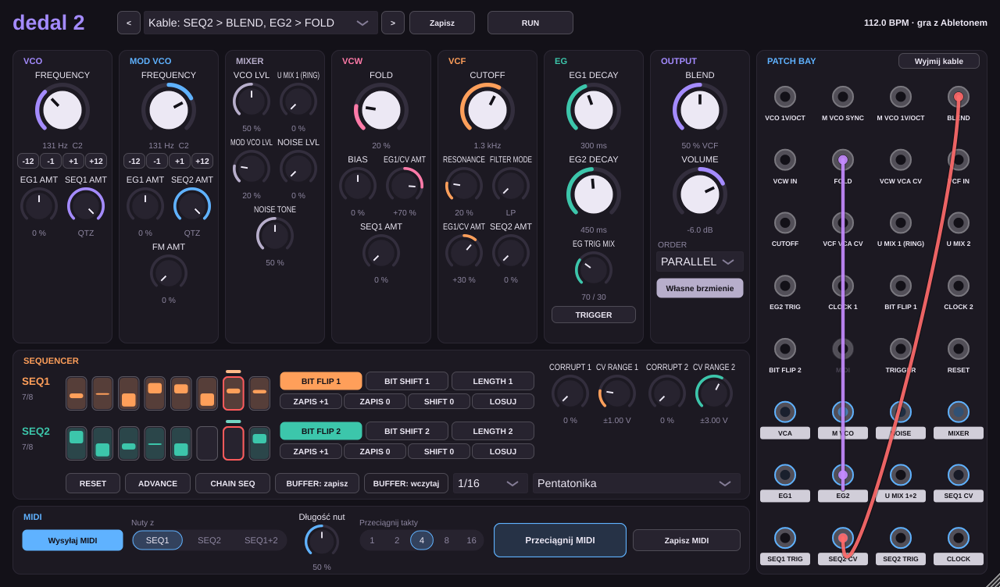

# Dedal 2

Ten sam generatywny głos co [Dedal](../dedal/README.md), ale ułożony moduł po module jak półmodularny syntezator z dwoma sekwencerami 8-bitowymi, z **patch bayem i kablami**. Nazwy gałek, przycisków i gniazd są takie jak w instrumencie, na którym się wzoruje, więc patche z tutoriali da się odtwarzać krok po kroku. Wygląd jest własny.

Pliki: **Releases** → `Dedal2-Windows-VST3.zip`, `Dedal2-macOS-VST3.zip`, `Dedal2-macOS-AU.zip`.

## Moduły

- **VCO** (sinus): FREQUENCY, EG1 AMT, SEQ1 AMT (na końcu skali: QTZ).
- **MOD VCO** (trójkąt): FREQUENCY (od LFO do ok. 1,3 kHz), EG1 AMT, SEQ2 AMT, FM AMT (thru-zero).
- **MIXER**: VCO LVL, U MIX 1 (RING), MOD VCO LVL, NOISE LVL, NOISE TONE. Powyżej połowy kanały się przesterowują (ring nie).
- **VCW**: FOLD, BIAS, EG1/CV AMT, SEQ1 AMT.
- **VCF**: CUTOFF, RESONANCE, EG1/CV AMT, SEQ2 AMT, FILTER MODE (LP → BP).
- **EG**: EG1 DECAY, EG2 DECAY, EG TRIG MIX, TRIGGER.
- **OUTPUT**: BLEND, ORDER (PARALLEL, VCW > VCF, VCF > VCW), VOLUME.
- **SEQUENCER**: dla każdego sekwencera 8 bitów, CORRUPT, CV RANGE (do ±5 V, czyli pięć oktaw), BIT FLIP, BIT SHIFT, LENGTH. Wspólne: RUN, RESET, ADVANCE, CHAIN SEQ, BUFFER.

Różnice wobec sprzętu: TEMPO to podział tempa Abletona (lista 1/1 … 1/32), a tryb kwantyzacji wybierasz z listy zamiast kombinacją przycisków. Dodatkowe małe przyciski: ZAPIS +1 / ZAPIS 0 (przesunięcie głowicy zapisu), SHIFT 0 (cofa obroty), LOSUJ.

## Patch bay

19 wejść i 12 wyjść (gniazdo MIDI jest tylko narysowane, MIDI idzie przez Abletona).

- **Kabel**: przeciągnij od jednego gniazda do drugiego (wyjście ↔ wejście, w dowolną stronę).
- **Wyjęcie**: kliknij wejście, w którym siedzi kabel. **Wyjmij kable** usuwa wszystkie.
- Z jednego wyjścia może iść wiele kabli, do wejścia wchodzi jeden.
- Kable niosą dźwięk i sterowanie, liczone co próbkę.

Połączenia domyślne, które kabel przerywa:

| Wejście | Domyślnie |
| --- | --- |
| FOLD, CUTOFF | EG1 (przez gałkę EG1/CV AMT, która tłumi też sygnał z kabla) |
| VCW VCA CV, VCF VCA CV | EG2 |
| U MIX 1 (RING) | ring modulator (VCO × MOD VCO) |
| VCW IN, VCF IN | według ORDER |
| CLOCK 1 | zegar wewnętrzny |
| CLOCK 2 | to samo, co taktuje SEQ1 |
| TRIGGER | wyzwala EG1 i EG2; gdy EG2 TRIG ma kabel, tylko EG1 |

Wyjścia: VCA, M VCO, NOISE, MIXER, EG1, EG2, U MIX 1+2, SEQ1 CV, SEQ1 TRIG, SEQ2 CV, SEQ2 TRIG, CLOCK.

## Reszta

Nuty wysyła jako MIDI (ustawienie ścieżki jak w Dedalu), ostatnie takty można przeciągnąć jako klip, presety zapisują gałki, sekwencje i kable w `Dokumenty/Dedal 2/Presety`. Nuta z klawiatury ustawia tonikę (FREQUENCY VCO).

## Czego nie sprawdziłem

Testy offline przechodzą (normalizacje, zegar z kabla, RESET, audio przez kabel, strojenie, zapis kabli). Wtyczka nie była uruchomiona w Abletonie i nie porównywałem jej ze sprzętem: zakresy gałek i charakter brzmienia są przybliżone według instrukcji.

## Presety według instrukcji

Dwanaście ostatnich presetów fabrycznych (*A Simple Start* … *The Ooze*) powstało na podstawie opisów przykładowych patchy z instrukcji sprzętu: skala, kable, włączone bity i to, które gałki są w patchu ważne. Pozycje gałek są w instrukcji tylko na rysunkach, więc ustawiłem je sam według opisu brzmienia. To przybliżenia, nie kopie.

## Strojenie bez ucha

Pod FREQUENCY obu oscylatorów są przyciski **-12, -1, +1, +12**. Przesuwają wysokość dokładnie o półton albo oktawę i przy okazji zaokrąglają ją do pełnego półtonu, więc VCO i MOD VCO łatwo ustawić w czystym interwale (np. +7 = kwinta, +12 = oktawa).
