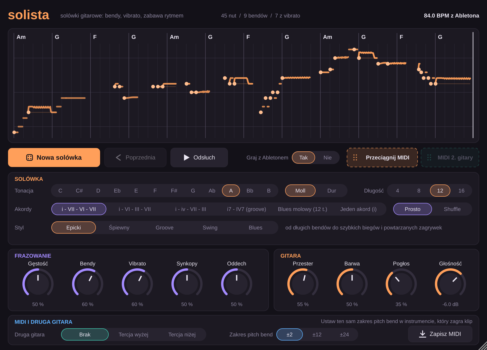

# Solista

Wtyczka VST3, która wymyśla solówki na gitarę prowadzącą: z bendami, vibrato, slajdami i zabawą rytmem. Gra je własnym brzmieniem gitary w tempie Abletona, a gotową solówkę przeciągasz jako klip MIDI na ścieżkę.

Każda solówka jest układana od zera z ogólnych gitarowych środków (pentatonika i skala, dźwięki akordów, pytanie i odpowiedź, powtarzane figury, przesunięcia rytmiczne). We wtyczce nie ma zapisanych żadnych fragmentów istniejących utworów, więc nie cytuje cudzych solówek.

## Pobieranie i instalacja

Pliki są w zakładce **Releases** → *Gizmo i Solista (najnowsza wersja)*: `Solista-Windows-VST3.zip`, `Solista-macOS-VST3.zip`, `Solista-macOS-AU.zip`. Instalacja jest taka sama jak dla Gizmo (opis w [głównym README](../README.md)), tylko z nazwą `Solista` zamiast `Gizmo`.

## Jak tego używać

1. Wrzuć **Solistę** na ścieżkę MIDI w Abletonie. Tempo bierze z projektu.
2. Wybierz **tonację** (dźwięk i moll/dur), **akordy**, **długość** (4, 8, 12 albo 16 taktów) i **styl**.
3. Włącz odtwarzanie w Abletonie: solówka gra w pętli razem z projektem. Gdy Ableton stoi, użyj przycisku **Odsłuch**.
4. **Nowa solówka** losuje kolejną, **Poprzednia** wraca do wcześniejszej.
5. Gdy trafisz na dobrą, złap uchwyt **Przeciągnij MIDI** i upuść go na ścieżkę. Klip zawiera nuty i krzywą pitch bend. Podgląd wyłącza się wtedy sam, żeby solówka nie grała podwójnie.

Klip możesz zostawić na ścieżce z Solistą (zagra go tym samym brzmieniem) albo dać na inny instrument. W tym drugim przypadku ustaw w instrumencie ten sam **zakres pitch bend**, który jest wybrany we wtyczce (±2, ±12 albo ±24 półtony), inaczej bendy będą fałszować.

## Style

| Styl | Charakter |
| --- | --- |
| **Epicki** | zaczyna długimi, śpiewnymi bendami, potem przyspiesza: biegi po pentatonice, powtarzane zagrywki, mocne zakończenie |
| **Śpiewny** | melodia prowadzona jak głos, po całej skali: slajdy, pre-bendy, szerokie vibrato |
| **Groove** | krótkie, rytmiczne figury z pauzami, akcenty obok bitu, powtórzenia przesunięte o szesnastkę |
| **Swing** | melodie po dźwiękach akordów, luźno; dobrze brzmi z pulsem *Shuffle* |
| **Blues** | wolne bendy, spóźnione vibrato, granie za bitem, dwudźwięki, „niebieska" nuta |

## Gałki

**Frazowanie**

- **Gęstość**: ile nut i jak szybkie biegi.
- **Bendy**: jak często struna jest podciągana. Bendy są różne: szybkie, wolne, podciągnięcie z opuszczeniem, pre-bend, dwustopniowy, ćwierćtonowe „zabrudzenie".
- **Vibrato**: jak często i jak szeroko. Każda nuta dostaje własne: jedne wcale, inne wąskie i szybkie, inne szerokie, spóźnione albo narastające, tak jak przy grze na żywo.
- **Synkopy**: wejścia obok bitu, nuty wyprzedzające takt, powtórzenia motywu przesunięte w rytmie.
- **Oddech**: długość pauz między frazami.

**Gitara**: Przester, Barwa, Pogłos, Głośność.

**Druga gitara** dokłada drugi głos w tercji (wyżej albo niżej), z własnym vibrato i lekko innym timingiem. Ma osobny uchwyt MIDI, żeby dało się ją położyć na drugiej ścieżce.

## Widok solówki

Każda nuta jest narysowana jako jej prawdziwa wysokość w czasie: bend widać jako linię wznoszącą się od progu, vibrato jako falowanie. Kropka na początku oznacza uderzenie kostką; nuty bez kropki to legato (hammer-on, pull-off). Nad taktami są nazwy akordów.

## Czego nie sprawdziłem

Wtyczka jest budowana i testowana automatycznie (generator, strojenie gitary, synchronizacja z tempem, plik MIDI), ale nie była uruchamiana w samym Abletonie. Jeśli przeciąganie MIDI nie zadziała, użyj przycisku **Zapisz MIDI** i przeciągnij zapisany plik.
